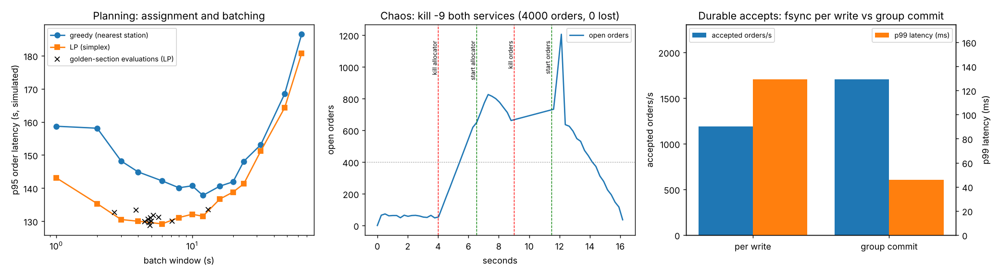

# Fulfillment-center robot orchestration: fault-tolerant Java services with LP planning

[](https://github.com/vansh0906/fc-orchestrator/actions/workflows/ci.yml)

Two Java 21 microservices that take customer orders and turn them into drive-unit missions on a goods-to-person
fulfillment floor. They are built to survive crashes without losing or double-completing an order, plan with a linear
program, and are tuned with nonlinear optimization. Plain JDK: no frameworks, no dependencies.

```
 clients ──POST /orders──► order-service ──batched, at-least-once──► allocator ──► drive units / pick stations
   (retry with the          WAL + idempotency                        WAL + dedup    (simulated floor,
    same order id)           metrics, alarms   ◄──batched completion──  LP planner     accelerated time)
                                                   callbacks (outbox)
```

**Simulated:** the warehouse floor (drive units, pods, pick stations), in accelerated time. **Real:** the services,
HTTP traffic, write-ahead logs and fsyncs, the `kill -9` crashes, the optimization code and every number below.

## Results

| Question | Answer |
|---|---|
| Crash both services with `kill -9` under load (4,000 orders at 250/s) | **4,000 / 4,000 done, 0 lost, 0 completed twice**; 151 client retries and 93 duplicate requests absorbed; backlog drained **0.4 s** after load ended |
| Do the alarms work? | **OrderBacklogHigh** and **DependencyDown** fired during each outage and cleared after recovery ([RUNBOOK](docs/RUNBOOK.md)) |
| LP vs greedy station assignment (floor model, 4 h, 85% station load) | best p95 order latency **129.2 s vs 137.8 s** (6% lower), **3.6% less drive-unit travel** at the same window, drive-unit utilisation 0.80 vs 0.82 |
| Simplex correctness | equals brute force on **300 random problems**; every transportation solution is integral |
| Best batching window (nonlinear, derivative-free) | golden-section search on log(window): **4.9 s, p95 128.7 s in 12 simulations** (grid of 14 windows: best 6 s, 129.2 s) |
| Durable accepts: fsync per write vs group commit | **1,191 → 1,706 orders/s (+43%)**, p99 **129 → 46 ms**, fsyncs per order 1.02 → 0.53 |
| SQL analytics over the WALs | latency per phase of the outage, per station, double-completion check (SQLite) |

Full tables: [results/RESULTS.md](results/RESULTS.md) · what was found and changed: [docs/FINDINGS.md](docs/FINDINGS.md) ·
API: [docs/API.md](docs/API.md)



## Run it

Needs JDK 21 and Python 3 (standard library, plus Matplotlib for the figure).

```
tools/build.sh                 # javac -Werror + 28 unit checks, a few seconds
python3 tools/run_all.py       # floor model, chaos test, load test, analytics, figure: about 35 s
```

Or run the services yourself:

```
java -cp out fc.OrderService --port 8101 --data data/orders
java -cp out fc.Allocator --port 8102 --data data/allocator --scale 0.002
curl -X POST localhost:8101/orders -d '{"id":"A-1","skus":[12,40]}'
curl localhost:8101/orders/A-1
curl localhost:8101/metrics
```

## Layout

```
src/main/java/fc/OrderService.java   front door: idempotent accepts, WAL, batched forwarder with backoff + breaker
src/main/java/fc/Allocator.java      dedup, LP/greedy planning per window, drive-unit and station model, outbox
src/main/java/fc/Planner.java        station assignment as a transportation LP; greedy baseline; warehouse layout
src/main/java/fc/Simplex.java        dense tableau simplex (big-M, Bland's rule)
src/main/java/fc/Sim.java            discrete-event floor model; batch-window sweep; golden-section search
src/main/java/fc/Wal.java            write-ahead log: per-write fsync or group commit; torn-tail recovery
src/main/java/fc/Http.java           JDK HTTP server; client with timeouts, exponential backoff + jitter, circuit breaker
src/main/java/fc/Metrics.java        counters, gauges, latency percentiles in Prometheus text format
src/test/java/fc/Tests.java          28 unit checks (no framework)
tools/chaos.py                       kill -9 test with alarms; tools/loadtest.py: WAL modes; tools/analytics.py: SQL
```

## Limits

The floor is a model, not real robots, and both services run on one machine. Durability is a local disk per service,
not replicated storage. How this maps onto AWS (SQS, DynamoDB, ECS) is in [docs/FINDINGS.md](docs/FINDINGS.md);
it is not deployed there.
